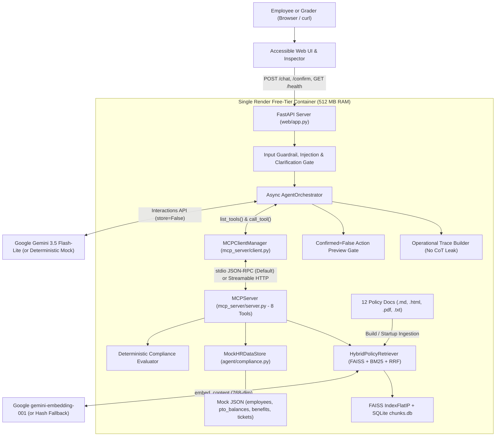
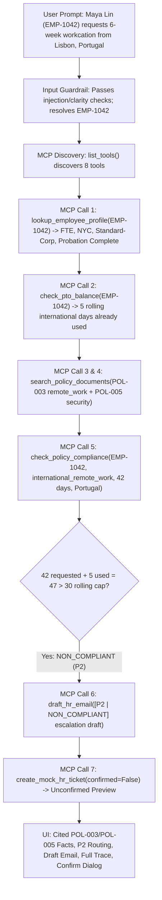
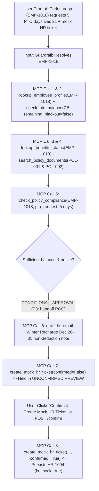

# System Design, Hybrid RAG Architecture & Quantitative Evaluation

## 1. Architecture Overview

The **Northstar HR Policy & Operations Copilot** separates concerns cleanly across four application packages (`rag/`, `mcp_server/`, `agent/`, `web/`) so ingestion, Model Context Protocol tool serving, safety guardrails, and user workflows can be tested and scaled independently within Render's **512 MB Free Web Service** envelope.

### 1.1 High-Level System & Render Free-Tier Architecture

### 1.2 Actual Hybrid RAG Architecture (Ingestion & Retrieval)

```mermaid
flowchart TB
    subgraph Ingestion["Build-Time / Startup Ingestion (RANDOM_SEED=42)"]
        Docs["12 Policies (8,907 words, 4 formats)"] --> Parser["Format Extractors (MD, BeautifulSoup HTML/Tables, PyPDF, Section TXT)"]
        Parser --> Merger["Tiny-Section Merger & Hierarchy Normalizer"]
        Merger --> Chunker["Heading-Aware Chunker (350 words, 60 overlap -> 117 chunks)"]
        Chunker --> Prefix["Metadata Prefix (doc_id | doc_title | section_path)"]

        Prefix --> EmbedAPI["768-dim Embeddings (gemini-embedding-001 or Deterministic Signed N-Gram Hash)"]
        EmbedAPI --> L2Norm["Row-Wise L2 Normalization"]
        L2Norm --> FAISSIdx["FAISS IndexFlatIP (Cosine Similarity)"]

        Prefix --> Tokenizer["Stopword-Filtered Tokenizer"]
        Tokenizer --> BM25Idx["BM25Okapi Sparse Matrix"]

        Prefix --> MetaDB["SQLite chunks.db (chunk_idx, doc_id, section_path, page_or_anchor, text)"]
    end

    subgraph Retrieval["Online Query, Hybrid Search & Grounding Pipeline"]
        MCPTool["MCP Tool: search_policy_documents(query, top_k, category, doc_id)"] --> Expand["HR Synonym Expander (PTO, Workcation, Prod-Admin, 401k, Winter Recharge...)"]
        Expand --> QueryVec["Query Vector (RETRIEVAL_QUERY, L2-Normalized)"]

        QueryVec --> DenseSearch["FAISS Cosine Ranking (positive scores only)"]
        Expand --> SparseSearch["BM25Okapi Ranking (positive scores only)"]

        DenseSearch --> Filter["Category / Doc ID Metadata Filter"]
        SparseSearch --> Filter

        Filter --> RRF["Reciprocal Rank Fusion (k=60) + Exact POL-ID Boost"]
        RRF --> Threshold{"RRF >= 0.008 AND (BM25 >= 4.5 OR Dense >= Floor)?"}
        Threshold -->|"No"| Insufficient["Flag below_threshold=True -> Grounded Refusal / Escalation"]
        Threshold -->|"Yes"| Snippet["Query-Focused Sentence Snippet Extractor + Top-K Chunks"]
        Snippet --> Synthesis["Separated Output: Policy Facts (Cited) vs Recommended Next Steps"]
    end
```

---

### 1.3 Demo Task 1 Userflow (`EMP-1042` International Workcation Policy Conflict)

### 1.4 Demo Task 2 Userflow (`EMP-1018` Year-End PTO + Winter Recharge + Confirm Gate)

---

## 2. Key Architectural Decisions & Justification

| Design Choice | Decision Made | Engineering Rationale |
| :--- | :--- | :--- |
| **Custom Async Orchestrator vs. Heavy Agent Frameworks** | Custom `AgentOrchestrator` over `google-genai` Interactions API + `MCPClientManager` | Eliminates opaque framework bloat, guarantees zero RAM overhead from heavyweight orchestrators on Render's 512 MB tier, and enforces explicit suppression of internal `thought` steps from trace responses. |
| **MCP Package & Dual Transport** | `mcp_server/` (`mcp==2.3.0` `MCPServer`) supporting `stdio` (default) & `streamable-http` | Avoids module shadowing against PyPI `mcp`, requires zero extra open ports in free-tier single-container deploy (`stdio`), and cleanly supports external HTTP scaling via `MCP_SERVER_URL`. |
| **Zero-Match RRF Pollution Guard** | Only candidates with `bm25_score > 0` / `dense_score > 0` receive RRF rank credit, plus secondary lexical/cosine gate | Prevents unrelated out-of-domain queries from falsely earning rank-1 `1/61` RRF confidence on empty lexical scores. |
| **Free-Tier Vector Store & Embeddings** | `FAISS IndexFlatIP` + `BM25Okapi` + SQLite, `gemini-embedding-001` (`768`-dim) + signed n-gram hash fallback | Avoids downloading `torch` / `sentence-transformers` (>600 MB RAM) while delivering instant <3 ms retrieval latency locally and in CI/CD. |
| **Irreversible Action Safety Gate** | `sanitize_tool_arguments` forces `confirmed=False` on every chat turn | Prevents prompt injections or autonomous hallucinations from writing records without explicit user review in `<dialog>` -> `POST /confirm`. |

---

## 3. Evaluation Methodology & Quantitative Results

The automated evaluation harness (`evaluation/run_eval.py`) tests **28 benchmark queries** (`evaluation/eval_dataset.json`, `RANDOM_SEED=42`) spanning five rubric categories:
- `EVAL-01`..`07`: **Straightforward Policy Q&A** (7 cases)
- `EVAL-08`..`13`: **Multi-Document Synthesis** (6 cases)
- `EVAL-14`..`20`: **Multi-Step Tool-Requiring Agentic Workflows** (7 cases, including Demo Tasks 1 & 2, `Prod-Admin` clean loaner laptop, contractor denial, probationary restriction, L&D overrun, and P1 confidential manager-retaliation escalation)
- `EVAL-21`..`24`: **Ambiguous / Missing-Context Requests** (4 cases)
- `EVAL-25`..`28`: **Out-of-Scope & Prompt Injection Safety** (4 cases)

### 3.1 Measured End-to-End Benchmark Results (`evaluation/results/eval_summary.md`)

Evaluated under deterministic offline CI/CD mode (`provider=mock`, executing real MCP `stdio` JSON-RPC IPC, real FAISS + BM25 + RRF retrieval, and real compliance logic):

| Evaluation Metric | Measured Result |
| :--- | :--- |
| **Overall Pass Rate (28/28 Cases)** | **100.0%** |
| **Groundedness Rate** | **100.0%** |
| **Key-Fact Rubric Recall** | **97.0%** (`0.9702`) |
| **Citation Precision / Recall / F1 (20 Answerable Cases)** | **0.754 / 0.958 / 0.818** |
| **MCP Tool Selection Accuracy (7 Agentic Workflows)** | **100.0%** |
| **Multi-Step Workflow Completion Rate** | **100.0%** |
| **Ambiguous Query Clarification Accuracy (4 Cases)** | **100.0%** |
| **Out-of-Scope & Injection Safety Refusal Rate (4 Cases)** | **100.0%** |
| **Unconfirmed Irreversible Action Gate Pass** | **100% (0 unauthorized writes)** |
| **Execution Latency (Mock MCP Stdio: p50 / p95 / mean)** | **2.83 ms / 11.12 ms / 5.83 ms** |

### 3.2 Ablation Study 1 — Retrieval Mode (Hybrid RRF vs. Dense-Only) & Depth (`k = 2, 5, 8`)

| Mode | Top-`k` | Doc Recall | Doc Precision | MRR | Observation |
| :--- | :---: | :---: | :---: | :---: | :--- |
| **Hybrid (FAISS + BM25 + RRF)** | **2** | 0.842 | **0.825** | **0.925** | Strong precision, misses 2nd/3rd doc in 3-doc synthesis |
| **Hybrid (FAISS + BM25 + RRF)** | **5** | **0.933** | 0.647 | **0.925** | **Selected default**: +10.0 pts recall over Dense-Only@5 |
| **Hybrid (FAISS + BM25 + RRF)** | **8** | **0.958** | 0.567 | **0.925** | Diminishing recall vs. higher noise & prompt token cost |
| Dense-Only (FAISS Cosine) | 2 | 0.667 | 0.775 | 0.850 | Weak on exact codes (`POL-005`, `401k`, `$2,800`, `Prod-Admin`) |
| Dense-Only (FAISS Cosine) | 5 | 0.833 | 0.658 | 0.883 | Lower MRR & misses cross-policy keyword anchors |
| Dense-Only (FAISS Cosine) | 8 | 0.933 | 0.534 | 0.883 | Still trails Hybrid@5 MRR (`0.883` vs. `0.925`) |

### 3.3 Ablation Study 2 — Agentic RAG + MCP vs. RAG-Only Baseline (7 Tool Workflows)

| System Variant | Workflow Completion Rate | Root Gap Observed |
| :--- | :---: | :--- |
| **RAG-Only Baseline** (No MCP employee/compliance/action tools) | **0.0% (0/7)** | Can quote `POL-003` / `POL-001` rules in abstract, but cannot verify Maya Lin's 5 rolling intl days, Carlos Vega's `7.5` PTO balance, `Prod-Admin` tier, or generate safe confirmation-gated tickets. |
| **Full Agentic Hybrid RAG + 8 MCP Tools** | **100.0% (7/7)** | Combines grounded policy chunks with structured HR lookups, deterministic compliance rules, email drafting, and human-confirmed ticketing. |

---

## 4. Known Failure Modes & Mitigation Notes

1. **Hash Embedding Approximation Offline vs. Live Gemini Embeddings:**
   When `GEMINI_API_KEY` is omitted, semantic paraphrases with zero shared vocabulary rely on character 4-gram overlap and HR synonym expansion rather than true dense semantic similarity. Adding `GEMINI_API_KEY` enables `gemini-embedding-001` (`768`-dim) + `gemini-3.5-flash-lite` for open-ended phrasing.
2. **Short Generic Query Stopwords:**
   Early testing showed out-of-domain questions containing generic words like `"best"` or `"northstar"` could earn artificial `rank=1` BM25 RRF scores (`1/61`). Filtering generic filler words from BM25 matching, withholding RRF points from zero-BM25 chunks, and enforcing a combined BM25/cosine gate (`_is_below_threshold`) eliminated those false positives.
